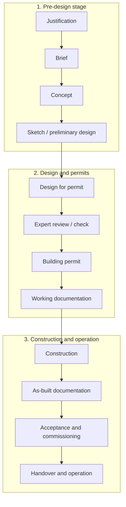

---
hide:
  - toc
---

# 1. Design and construction stages

!!! warning "Status: draft"
    The stage names are recorded from a first-pass review and a 2014 article (see [Sources](../istochniki.md)). Each cell must be checked against the current text of the standard until the status **verified** is set.

## How the matrix is built

Each stage name in the matrix links to a page with the scope of work, documents and level of detail by country (tabs).

Rows are the **union** of the stages of all countries, not their intersection. If a country has a stage with no analogue, it gets its own row, and the others show “—” with a note on where that work is done in their system.

**Legend:** ≈ full analogue · ◐ partial analogue · — no analogue · 🔸 stage exists in one country only

## Summary matrix

| № | Cross-country stage | Russia | Serbia | EU (EN 16310) | England (RIBA 2020) | UAE (Dubai) | Georgia | India |
|--:|---|---|---|---|---|---|---|---|
| 1 | [Strategy and justification](../stadii/01-strategiya.md) | ◐ practice: market study, development concept; no regulated stage <small>[ГрК РФ ст. 48](https://www.consultant.ru/document/cons_doc_LAW_51040/b884020ea7453099ba8bc9ca021b84982cadea7d/)</small> [More](../stadii/01-strategiya.md#ru){ .more } | ◐ *GNP* (general design), preliminary feasibility study, feasibility study <small>[Правилник чл. 2, 14, 34](https://www.paragraf.rs/propisi/pravilnik-o-sadrzini-nacinu-i-postupku-izrade-i-nacinu-vrsenja-kontrole-tehnicke-dokumentacije-prema-klasi-i-nameni-objekata.html); [Закон чл. 112–117](https://www.paragraf.rs/propisi/zakon_o_planiranju_i_izgradnji.html)</small> [More](../stadii/01-strategiya.md#rs){ .more } | ≈ **0** Initiative <small>[отчёт ACE 2013](https://oar.archi/wp-content/uploads/2021/03/the_design_and_construction_phases_of_a_construction_project_pdf_1478002177.pdf); [EN 16310 (iTeh)](https://standards.iteh.ai/catalog/standards/cen/7250e686-1a17-446c-bc6a-754708162070/en-16310-2013)</small> [More](../stadii/01-strategiya.md#eu){ .more } | ≈ **0** Strategic Definition <small>[RIBA Plan of Work 2020](https://www.riba.org/media/syneeeto/2020ribaplanofworkoverviewpdf.pdf)</small> [More](../stadii/01-strategiya.md#uk){ .more } | ◐ PMP — Preliminary Master Plan (overall vision and strategy for developing an area; master-plan level, not a building) <small>[DDA MPG](https://dda.gov.ae/-/media/0CDFF6B21C134DD793DA846C3525C17A.pdf)</small> [More](../stadii/01-strategiya.md#ae){ .more } | ◐ pre-design study (წინასაპროექტო კვლევა): topography, condition of the building, surroundings, documents, impact on neighbours, engineering geology — mandatory by class (Res. No. 255, Art. 6); there is no “strategy” stage <small>[Пост. № 255](https://matsne.gov.ge/ka/document/view/4578072)</small> [More](../stadii/01-strategiya.md#ge){ .more } | ⏳ no separate stage in the acts read (DCPR 2034 starts with the notice of intention to develop) <small>[DCPR 2034 (Большой Мумбаи), MCGM](https://portal.mcgm.gov.in/irj/go/km/docs/documents/MCGM%20Department%20List/Chief%20Engineer%20(Development%20Plan)/Docs/SANCTIONED%20DP2034/DCPR/DCPR%202034.pdf)</small> [More](../stadii/01-strategiya.md#in){ .more } |
| 2 | [Brief preparation](../stadii/02-zadanie.md) | ◐ design brief, GPZU (land-plot planning document), technical conditions, surveys <small>[ПП РФ № 87](https://mchs.gov.ru/dokumenty/697) п. 10; [ГрК РФ ст. 48](https://www.consultant.ru/document/cons_doc_LAW_51040/b884020ea7453099ba8bc9ca021b84982cadea7d/) ч. 11</small> [More](../stadii/02-zadanie.md#ru){ .more } | ◐ *lokacijski uslovi* — location conditions (based on the IDR), 5 working days <small>[Закон чл. 53а, 55–56, 8д](https://www.paragraf.rs/propisi/zakon_o_planiranju_i_izgradnji.html); [Правилник чл. 15](https://www.paragraf.rs/propisi/pravilnik-o-sadrzini-nacinu-i-postupku-izrade-i-nacinu-vrsenja-kontrole-tehnicke-dokumentacije-prema-klasi-i-nameni-objekata.html)</small> [More](../stadii/02-zadanie.md#rs){ .more } | ≈ **1** Initiation <small>[отчёт ACE 2013](https://oar.archi/wp-content/uploads/2021/03/the_design_and_construction_phases_of_a_construction_project_pdf_1478002177.pdf); [EN 16310 (iTeh)](https://standards.iteh.ai/catalog/standards/cen/7250e686-1a17-446c-bc6a-754708162070/en-16310-2013)</small> [More](../stadii/02-zadanie.md#eu){ .more } | ≈ **1** Preparation and Briefing <small>[RIBA Plan of Work 2020](https://www.riba.org/media/syneeeto/2020ribaplanofworkoverviewpdf.pdf)</small> [More](../stadii/02-zadanie.md#uk){ .more } | ⏳ not verified (site plan / DCR; the design brief is private practice) [More](../stadii/02-zadanie.md#ae){ .more } | ≈ permit stage I: conditions for using the plot for construction (მიწის ნაკვეთის სამშენებლოდ გამოყენების პირობები) — decision within 10 working days, valid for 3 years; content — type and parameters of development, lines, maximum height (Code, Arts. 103–105; Res. No. 255, Art. 8) <small>[Пост. № 255](https://matsne.gov.ge/ka/document/view/4578072); [Кодекс № 3213](https://matsne.gov.ge/ru/document/view/4276845)</small> [More](../stadii/02-zadanie.md#ge){ .more } | ◐ Notice of Intention: a written application to the Commissioner in the form of Appendix II with plans and particulars; plot conditions — zoning and FSI under DCPR (Parts V, VII ⏳) (DCPR, cl. 10(1)) <small>[DCPR 2034 (Большой Мумбаи), MCGM](https://portal.mcgm.gov.in/irj/go/km/docs/documents/MCGM%20Department%20List/Chief%20Engineer%20(Development%20Plan)/Docs/SANCTIONED%20DP2034/DCPR/DCPR%202034.pdf)</small> [More](../stadii/02-zadanie.md#in){ .more } |
| 3 | [Concept](../stadii/03-koncepciya.md) | ◐ AGK (Moscow practice) <small>[mos.ru/dgp](https://www.mos.ru/dgp/function/arkhitekturnaya-komissiya-po-rassmotreniyu-proektnykh-materialov/deyatelnost-arkhitekturnoi-komissii-po-rassmotreniyu-proektnykh-materialov/)</small> [More](../stadii/03-koncepciya.md#ru){ .more } | ≈ *IDR* — conceptual design <small>[Правилник чл. 15, 35–41](https://www.paragraf.rs/propisi/pravilnik-o-sadrzini-nacinu-i-postupku-izrade-i-nacinu-vrsenja-kontrole-tehnicke-dokumentacije-prema-klasi-i-nameni-objekata.html); [Закон чл. 117а](https://www.paragraf.rs/propisi/zakon_o_planiranju_i_izgradnji.html)</small> [More](../stadii/03-koncepciya.md#rs){ .more } | ≈ **2.1** Conceptual Design <small>[отчёт ACE 2013](https://oar.archi/wp-content/uploads/2021/03/the_design_and_construction_phases_of_a_construction_project_pdf_1478002177.pdf)</small> [More](../stadii/03-koncepciya.md#eu){ .more } | ≈ **2** Concept Design <small>[RIBA Plan of Work 2020](https://www.riba.org/media/syneeeto/2020ribaplanofworkoverviewpdf.pdf)</small> [More](../stadii/03-koncepciya.md#uk){ .more } | ⏳ not verified (building concept — outside the documents read) [More](../stadii/03-koncepciya.md#ae){ .more } | 🔸 no separate stage: the architectural concept (or part of it) is submitted as an architectural sketch (Res. No. 255, Art. 12, cl. 1; Code, Art. 113) <small>[Пост. № 255](https://matsne.gov.ge/ka/document/view/4578072); [Кодекс № 3213](https://matsne.gov.ge/ru/document/view/4276845)</small> [More](../stadii/03-koncepciya.md#ge){ .more } | ⏳ no separate concept stage in DCPR [More](../stadii/03-koncepciya.md#in){ .more } |
| 4 | [Sketch / preliminary design](../stadii/04-eskiz.md) | ◐ sketch design (EP) / feasibility study — practice, not in the Urban Planning Code <small>[ГрК РФ ст. 48](https://www.consultant.ru/document/cons_doc_LAW_51040/b884020ea7453099ba8bc9ca021b84982cadea7d/)</small> [More](../stadii/04-eskiz.md#ru){ .more } | ≈ *IDP* — sketch design <small>[Правилник чл. 16, 42–49](https://www.paragraf.rs/propisi/pravilnik-o-sadrzini-nacinu-i-postupku-izrade-i-nacinu-vrsenja-kontrole-tehnicke-dokumentacije-prema-klasi-i-nameni-objekata.html); [Закон чл. 118](https://www.paragraf.rs/propisi/zakon_o_planiranju_i_izgradnji.html)</small> [More](../stadii/04-eskiz.md#rs){ .more } | ≈ **2.2** Preliminary Design <small>[отчёт ACE 2013](https://oar.archi/wp-content/uploads/2021/03/the_design_and_construction_phases_of_a_construction_project_pdf_1478002177.pdf)</small> [More](../stadii/04-eskiz.md#eu){ .more } | ◐ **2** Concept Design (end of the stage) <small>[RIBA Plan of Work 2020](https://www.riba.org/media/syneeeto/2020ribaplanofworkoverviewpdf.pdf)</small> [More](../stadii/04-eskiz.md#uk){ .more } | ⏳ not verified [More](../stadii/04-eskiz.md#ae){ .more } | ≈ architectural sketch (არქიტექტურული ესკიზი): title page, explanatory note, technical and economic indicators, site diagram, facade diagrams (Res. No. 255, Art. 12) <small>[Пост. № 255](https://matsne.gov.ge/ka/document/view/4578072)</small> [More](../stadii/04-eskiz.md#ge){ .more } | ⏳ not found [More](../stadii/04-eskiz.md#in){ .more } |
| 5 | [Approval of architectural appearance](../stadii/05-ago-agr.md) | 🔸 AGO (federal), in Moscow — AGR <small>[ГрК ст. 40.1](https://grkodeksrf.ru/gl-4/st-40-1-grk-rf); [ПП Москвы № 1423-ПП](https://www.mos.ru/dgp/function/arkhitekturnaya-komissiya-po-rassmotreniyu-proektnykh-materialov/deyatelnost-arkhitekturnoi-komissii-po-rassmotreniyu-proektnykh-materialov/)</small> [More](../stadii/05-ago-agr.md#ru){ .more } | — [More](../stadii/05-ago-agr.md#rs){ .more } | — no general stage; example from Czechia: *Land Zone Permit Design* <small>[CKA 2017](https://en.cka.cz/++api++/resources/standards-of-architects-scope-of-services.pdf/@@download/file); [отчёт ACE 2013](https://oar.archi/wp-content/uploads/2021/03/the_design_and_construction_phases_of_a_construction_project_pdf_1478002177.pdf)</small> [More](../stadii/05-ago-agr.md#eu){ .more } | ◐ planning permission: 8 weeks (major applications — 13); for HRB, Gateway 1 <small>[RIBA Plan of Work 2020](https://www.riba.org/media/syneeeto/2020ribaplanofworkoverviewpdf.pdf); [Order 2015, art. 34](https://www.legislation.gov.uk/uksi/2015/595/article/34); [BSR](https://buildingsafety.campaign.gov.uk/wp-content/uploads/sites/157/2023/09/23_039-Building-Control-Authority-Booklet-3.pdf)</small> [More](../stadii/05-ago-agr.md#uk){ .more } | ◐ SOS and FMP — “Sign-off Sheet” and “Final Master Plan” (DDA): approval of the master plan and plots, not of the building’s architectural appearance <small>[DDA MPG](https://dda.gov.ae/-/media/0CDFF6B21C134DD793DA846C3525C17A.pdf)</small> [More](../stadii/05-ago-agr.md#ae){ .more } | ≈ preliminary decision (წინასწარი გადაწყვეტილება): approval of the architectural sketch by the permitting authority within 10 working days (Res. No. 255, Art. 34; Code, Arts. 113–114) <small>[Пост. № 255](https://matsne.gov.ge/ka/document/view/4578072); [Кодекс № 3213](https://matsne.gov.ge/ru/document/view/4276845)</small> [More](../stadii/05-ago-agr.md#ge){ .more } | ◐ Chief Fire Officer approval for high-rise and special buildings; special NOCs (DCPR, cl. 10(5)(ii), Appendix III) <small>[DCPR 2034 (Большой Мумбаи), MCGM](https://portal.mcgm.gov.in/irj/go/km/docs/documents/MCGM%20Department%20List/Chief%20Engineer%20(Development%20Plan)/Docs/SANCTIONED%20DP2034/DCPR/DCPR%202034.pdf)</small> [More](../stadii/05-ago-agr.md#in){ .more } |
| 6 | [Design for permit](../stadii/06-proekt-razresheniya.md) | ≈ design documentation, Stage P (12 sections) <small>[ПП РФ № 87](https://mchs.gov.ru/dokumenty/697); [ГрК РФ ст. 48](https://www.consultant.ru/document/cons_doc_LAW_51040/b884020ea7453099ba8bc9ca021b84982cadea7d/)</small> [More](../stadii/06-proekt-razresheniya.md#ru){ .more } | ≈ *PGD* — design for the building permit <small>[Правилник чл. 17, 51–57](https://www.paragraf.rs/propisi/pravilnik-o-sadrzini-nacinu-i-postupku-izrade-i-nacinu-vrsenja-kontrole-tehnicke-dokumentacije-prema-klasi-i-nameni-objekata.html); [Закон чл. 118а](https://www.paragraf.rs/propisi/zakon_o_planiranju_i_izgradnji.html)</small> [More](../stadii/06-proekt-razresheniya.md#rs){ .more } | ◐ **2.2–2.3**; the package is submitted at the end of Preliminary Design (example from France) <small>[отчёт ACE 2013](https://oar.archi/wp-content/uploads/2021/03/the_design_and_construction_phases_of_a_construction_project_pdf_1478002177.pdf)</small> [More](../stadii/06-proekt-razresheniya.md#eu){ .more } | ◐ **3** Spatial Coordination; Planning Application at the end of the stage <small>[RIBA Plan of Work 2020](https://www.riba.org/media/syneeeto/2020ribaplanofworkoverviewpdf.pdf)</small> [More](../stadii/06-proekt-razresheniya.md#uk){ .more } | ⏳ not verified: the DBC sets requirements for the design but not the content of the submission package <small>[DBC 2021](https://dda.gov.ae/-/media/DC97EA219133466D908BDEC8A462A2A8.pdf)</small> [More](../stadii/06-proekt-razresheniya.md#ae){ .more } | ≈ permit stage II: approval of the architectural design (არქიტექტურული პროექტი) — 17 working days (silence counts as approval), valid for 5 years until stage III; content — Res. No. 255, Art. 13 (Code, Arts. 106, 108) <small>[Пост. № 255](https://matsne.gov.ge/ka/document/view/4578072); [Кодекс № 3213](https://matsne.gov.ge/ru/document/view/4276845)</small> [More](../stadii/06-proekt-razresheniya.md#ge){ .more } | ≈ plans and particulars signed by the owner and a licensed professional / architect (Professional on Record) (DCPR, cl. 10(2)–(4), Appendix 10) <small>[DCPR 2034 (Большой Мумбаи), MCGM](https://portal.mcgm.gov.in/irj/go/km/docs/documents/MCGM%20Department%20List/Chief%20Engineer%20(Development%20Plan)/Docs/SANCTIONED%20DP2034/DCPR/DCPR%202034.pdf)</small> [More](../stadii/06-proekt-razresheniya.md#in){ .more } |
| 7 | [Review / expert examination](../stadii/07-ekspertiza.md) | 🔸 expert review of design documentation and surveys <small>[ст. 49](https://www.consultant.ru/document/cons_doc_LAW_51040/4ca003dd6b793db91e6027babe790a482edd9b7e/)</small> [More](../stadii/07-ekspertiza.md#ru){ .more } | ◐ *tehnička kontrola* of the PGD; *revizija* of the GNP and IDP <small>[Правилник чл. 79–86](https://www.paragraf.rs/propisi/pravilnik-o-sadrzini-nacinu-i-postupku-izrade-i-nacinu-vrsenja-kontrole-tehnicke-dokumentacije-prema-klasi-i-nameni-objekata.html); [Закон чл. 129, 131](https://www.paragraf.rs/propisi/zakon_o_planiranju_i_izgradnji.html)</small> [More](../stadii/07-ekspertiza.md#rs){ .more } | — (national law; example from France: technical controller) <small>[отчёт ACE 2013](https://oar.archi/wp-content/uploads/2021/03/the_design_and_construction_phases_of_a_construction_project_pdf_1478002177.pdf)</small> [More](../stadii/07-ekspertiza.md#eu){ .more } | ◐ Building Control (Full Plans / Building Notice); for HRB — Gateway 2 of the BSR before work starts <small>[reg. 12](https://www.legislation.gov.uk/uksi/2010/2214/regulation/12); [gov.uk](https://www.gov.uk/building-regulations-approval); [BSR](https://buildingsafety.campaign.gov.uk/wp-content/uploads/sites/157/2023/09/23_039-Building-Control-Authority-Booklet-3.pdf)</small> [More](../stadii/07-ekspertiza.md#uk){ .more } | ⏳ not verified: the MPG provides for approvals by “Service Authorities” (NOC); timing, content and procedure — ⏳ <small>[DDA MPG](https://dda.gov.ae/-/media/0CDFF6B21C134DD793DA846C3525C17A.pdf)</small> [More](../stadii/07-ekspertiza.md#ae){ .more } | ≈ mandatory expert review of designs (საექსპერტო შეფასება): detailed architectural — classes III–IV; engineering-geological and structural — II–IV; carried out by an accredited body or a certified expert (Res. No. 255, Art. 21) <small>[Пост. № 255](https://matsne.gov.ge/ka/document/view/4578072)</small> [More](../stadii/07-ekspertiza.md#ge){ .more } | ≈ review and decision by the Commissioner (approve, refuse or approve with changes); for high-rise buildings — approval by the Chief Fire Officer; the norms read contain no separate independent expert review (DCPR, cl. 10(5)) <small>[DCPR 2034 (Большой Мумбаи), MCGM](https://portal.mcgm.gov.in/irj/go/km/docs/documents/MCGM%20Department%20List/Chief%20Engineer%20(Development%20Plan)/Docs/SANCTIONED%20DP2034/DCPR/DCPR%202034.pdf)</small> [More](../stadii/07-ekspertiza.md#in){ .more } |
| 8 | [Building permit](../stadii/08-razreshenie.md) | ≈ building permit <small>[ГрК РФ ст. 51](https://grkodeksrf.ru/gl-6/st-51-grk-rf)</small> [More](../stadii/08-razreshenie.md#ru){ .more } | ≈ *građevinska dozvola* — building permit, 5 working days <small>[Закон чл. 135, 8д](https://www.paragraf.rs/propisi/zakon_o_planiranju_i_izgradnji.html); [Правилник чл. 17](https://www.paragraf.rs/propisi/pravilnik-o-sadrzini-nacinu-i-postupku-izrade-i-nacinu-vrsenja-kontrole-tehnicke-dokumentacije-prema-klasi-i-nameni-objekata.html)</small> [More](../stadii/08-razreshenie.md#rs){ .more } | — *Statutory approval*: national law <small>[EN 16310 (iTeh)](https://standards.iteh.ai/catalog/standards/cen/7250e686-1a17-446c-bc6a-754708162070/en-16310-2013); [отчёт ACE 2013](https://oar.archi/wp-content/uploads/2021/03/the_design_and_construction_phases_of_a_construction_project_pdf_1478002177.pdf)</small> [More](../stadii/08-razreshenie.md#eu){ .more } | ◐ planning permission + Building Regulations (application at Stage 4; for HRB — Gateway 2) <small>[RIBA Plan of Work 2020](https://www.riba.org/media/syneeeto/2020ribaplanofworkoverviewpdf.pdf); [reg. 16](https://www.legislation.gov.uk/uksi/2010/2214/regulation/16)</small> [More](../stadii/08-razreshenie.md#uk){ .more } | ⏳ not verified [More](../stadii/08-razreshenie.md#ae){ .more } | ≈ stage III: building permit — 20 working days (5 for the three-stage procedure); silence counts as issued; for class I — a simple notification (5 working days), for class II at the municipality’s decision — a detailed one (10) (Code, Arts. 94, 107; Res. No. 255, Arts. 24–25) <small>[Пост. № 255](https://matsne.gov.ge/ka/document/view/4578072); [Кодекс № 3213](https://matsne.gov.ge/ru/document/view/4276845)</small> [More](../stadii/08-razreshenie.md#ge){ .more } | ≈ development permission (Development Permission / Commencement Certificate): deemed issued if there is no reply within 60 days; valid for 4 years (renewed annually) (DCPR, cl. 10(5)(iii), 10(6)) <small>[DCPR 2034 (Большой Мумбаи), MCGM](https://portal.mcgm.gov.in/irj/go/km/docs/documents/MCGM%20Department%20List/Chief%20Engineer%20(Development%20Plan)/Docs/SANCTIONED%20DP2034/DCPR/DCPR%202034.pdf)</small> [More](../stadii/08-razreshenie.md#in){ .more } |
| 9 | [Working documentation](../stadii/09-rabochaya.md) | ≈ working documentation, Stage R (RD) <small>[ГОСТ Р 21.101-2020](https://meganorm.ru/Data2/1/4293720/4293720404.htm) п. 4.2; [ГрК РФ ст. 48](https://www.consultant.ru/document/cons_doc_LAW_51040/b884020ea7453099ba8bc9ca021b84982cadea7d/)</small> [More](../stadii/09-rabochaya.md#ru){ .more } | ≈ *PZI* — design for execution of works <small>[Правилник чл. 18, 61–70](https://www.paragraf.rs/propisi/pravilnik-o-sadrzini-nacinu-i-postupku-izrade-i-nacinu-vrsenja-kontrole-tehnicke-dokumentacije-prema-klasi-i-nameni-objekata.html); [Закон чл. 123](https://www.paragraf.rs/propisi/zakon_o_planiranju_i_izgradnji.html)</small> [More](../stadii/09-rabochaya.md#rs){ .more } | ≈ **2.3** Developed, **2.4** Technical Design/FEED, **2.5** Detailed Engineering <small>[отчёт ACE 2013](https://oar.archi/wp-content/uploads/2021/03/the_design_and_construction_phases_of_a_construction_project_pdf_1478002177.pdf)</small> [More](../stadii/09-rabochaya.md#eu){ .more } | ≈ **4** Technical Design <small>[RIBA Plan of Work 2020](https://www.riba.org/media/syneeeto/2020ribaplanofworkoverviewpdf.pdf)</small> [More](../stadii/09-rabochaya.md#uk){ .more } | ⏳ not verified [More](../stadii/09-rabochaya.md#ae){ .more } | ◐ detailed architectural design (დეტალური არქიტექტურული პროექტი) — refines the architectural design; as part of the permit documentation for classes III–IV it is subject to expert review (Res. No. 255, Arts. 14, 21); the acts read contain no separate “working documentation” stage <small>[Пост. № 255](https://matsne.gov.ge/ka/document/view/4578072)</small> [More](../stadii/09-rabochaya.md#ge){ .more } | ⏳ no separate working-documentation stage in the norms read (Appendices 5–8: opinions of the structural engineer, plumber, technical supervisor) [More](../stadii/09-rabochaya.md#in){ .more } |
| 10 | [Construction](../stadii/10-stroitelstvo.md) | ≈ construction, construction control, supervision (GSN) <small>[ст. 52](https://grkodeksrf.ru/gl-6/st-52-grk-rf); [53](https://grkodeksrf.ru/gl-6/st-53-grk-rf); [54](https://grkodeksrf.ru/gl-6/st-54-grk-rf)</small> [More](../stadii/10-stroitelstvo.md#ru){ .more } | ≈ *izvođenje radova* — *prijava radova* (notice of commencement), *stručni nadzor* <small>[Закон чл. 148–153](https://www.paragraf.rs/propisi/zakon_o_planiranju_i_izgradnji.html)</small> [More](../stadii/10-stroitelstvo.md#rs){ .more } | ≈ **3** Procurement, **4.1–4.2** Pre-construction, Construction <small>[отчёт ACE 2013](https://oar.archi/wp-content/uploads/2021/03/the_design_and_construction_phases_of_a_construction_project_pdf_1478002177.pdf)</small> [More](../stadii/10-stroitelstvo.md#eu){ .more } | ≈ **5** Manufacturing and Construction <small>[RIBA Plan of Work 2020](https://www.riba.org/media/syneeeto/2020ribaplanofworkoverviewpdf.pdf)</small> [More](../stadii/10-stroitelstvo.md#uk){ .more } | ⏳ not verified [More](../stadii/10-stroitelstvo.md#ae){ .more } | ≈ carrying out construction: construction organisation project; at least two series — preparatory and main works; acceptance of stages and supervision (Res. No. 255, Art. 20) <small>[Пост. № 255](https://matsne.gov.ge/ka/document/view/4578072)</small> [More](../stadii/10-stroitelstvo.md#ge){ .more } | ◐ notice of commencement (work may start after 7 days), check up to plinth level (inspection within 15 days, otherwise deemed allowed), approval of deviations, inspections (DCPR, cl. 11(2)–(5), 12) <small>[DCPR 2034 (Большой Мумбаи), MCGM](https://portal.mcgm.gov.in/irj/go/km/docs/documents/MCGM%20Department%20List/Chief%20Engineer%20(Development%20Plan)/Docs/SANCTIONED%20DP2034/DCPR/DCPR%202034.pdf)</small> [More](../stadii/10-stroitelstvo.md#in){ .more } |
| 11 | [As-built documentation](../stadii/11-ispolnitelnaya.md) | ≈ as-built documentation, inspection certificates for concealed works <small>[ст. 52](https://grkodeksrf.ru/gl-6/st-52-grk-rf); [53](https://grkodeksrf.ru/gl-6/st-53-grk-rf)</small> [More](../stadii/11-ispolnitelnaya.md#ru){ .more } | ≈ *PIO* — as-built design <small>[Правилник чл. 19, 71–78](https://www.paragraf.rs/propisi/pravilnik-o-sadrzini-nacinu-i-postupku-izrade-i-nacinu-vrsenja-kontrole-tehnicke-dokumentacije-prema-klasi-i-nameni-objekata.html); [Закон чл. 124](https://www.paragraf.rs/propisi/zakon_o_planiranju_i_izgradnji.html)</small> [More](../stadii/11-ispolnitelnaya.md#rs){ .more } | — (⏳ not verified) [More](../stadii/11-ispolnitelnaya.md#eu){ .more } | ◐ Verified Construction Information (Stage 5); for HRB — the “golden thread” <small>[RIBA Plan of Work 2020](https://www.riba.org/media/syneeeto/2020ribaplanofworkoverviewpdf.pdf); [BSR](https://buildingsafety.campaign.gov.uk/wp-content/uploads/sites/157/2023/09/23_039-Building-Control-Authority-Booklet-3.pdf)</small> [More](../stadii/11-ispolnitelnaya.md#uk){ .more } | ⏳ not verified [More](../stadii/11-ispolnitelnaya.md#ae){ .more } | ≈ at acceptance: stage reports, measured plan (as-built survey) of the building in its final form, photographs, cadastral survey drawing, equipment documents (Res. No. 255, Art. 30, cl. 3) <small>[Пост. № 255](https://matsne.gov.ge/ka/document/view/4578072)</small> [More](../stadii/11-ispolnitelnaya.md#ge){ .more } | ≈ completion certificates: sewerage (Appendix 17), building (Appendix 18) with three sets of as-built plans; acceptance of completion (Appendix 19) (DCPR, cl. 11(6)) <small>[DCPR 2034 (Большой Мумбаи), MCGM](https://portal.mcgm.gov.in/irj/go/km/docs/documents/MCGM%20Department%20List/Chief%20Engineer%20(Development%20Plan)/Docs/SANCTIONED%20DP2034/DCPR/DCPR%202034.pdf)</small> [More](../stadii/11-ispolnitelnaya.md#in){ .more } |
| 12 | [Acceptance and commissioning permit](../stadii/12-priemka-vvod.md) | ≈ certificate of compliance → commissioning permit <small>[ст. 54](https://grkodeksrf.ru/gl-6/st-54-grk-rf); [55](https://grkodeksrf.ru/gl-6/st-55-grk-rf)</small> [More](../stadii/12-priemka-vvod.md#ru){ .more } | ≈ *tehnički pregled* → *upotrebna dozvola* (use permit), 5 working days <small>[Закон чл. 154–158](https://www.paragraf.rs/propisi/zakon_o_planiranju_i_izgradnji.html)</small> [More](../stadii/12-priemka-vvod.md#rs){ .more } | ◐ **4.3** Commissioning, **4.5** Regulatory approval <small>[отчёт ACE 2013](https://oar.archi/wp-content/uploads/2021/03/the_design_and_construction_phases_of_a_construction_project_pdf_1478002177.pdf)</small> [More](../stadii/12-priemka-vvod.md#eu){ .more } | ◐ Practical Completion; completion certificate within 8 weeks; for HRB — Gateway 3 <small>[RIBA Plan of Work 2020](https://www.riba.org/media/syneeeto/2020ribaplanofworkoverviewpdf.pdf); [reg. 17](https://www.legislation.gov.uk/uksi/2010/2214/regulation/17); [BSR](https://buildingsafety.campaign.gov.uk/wp-content/uploads/sites/157/2023/09/23_039-Building-Control-Authority-Booklet-3.pdf)</small> [More](../stadii/12-priemka-vvod.md#uk){ .more } | ⏳ not verified [More](../stadii/12-priemka-vvod.md#ae){ .more } | ≈ recognition as fit for use (ექსპლუატაციაში მიღებისათვის ვარგისად აღიარება): classes II–III — 15–20 working days, class IV — 30 working days; not required for class I (Res. No. 255, Arts. 29–31) <small>[Пост. № 255](https://matsne.gov.ge/ka/document/view/4578072)</small> [More](../stadii/12-priemka-vvod.md#ge){ .more } | ≈ Occupancy Certificate: the Commissioner issues or refuses it within 21 days, otherwise the building is deemed accepted for occupation; for high-rise buildings — only after the Chief Fire Officer’s approval; a partial OC is possible (DCPR, cl. 11(7)–(8), 12(2)) <small>[DCPR 2034 (Большой Мумбаи), MCGM](https://portal.mcgm.gov.in/irj/go/km/docs/documents/MCGM%20Department%20List/Chief%20Engineer%20(Development%20Plan)/Docs/SANCTIONED%20DP2034/DCPR/DCPR%202034.pdf)</small> [More](../stadii/12-priemka-vvod.md#in){ .more } |
| 13 | [Handover to the client](../stadii/13-peredacha.md) | — (⏳ the Urban Planning Code does not single out this stage) [More](../stadii/13-peredacha.md#ru){ .more } | — [More](../stadii/13-peredacha.md#rs){ .more } | ≈ **4.4** Hand over <small>[отчёт ACE 2013](https://oar.archi/wp-content/uploads/2021/03/the_design_and_construction_phases_of_a_construction_project_pdf_1478002177.pdf)</small> [More](../stadii/13-peredacha.md#eu){ .more } | ≈ **6** Handover <small>[RIBA Plan of Work 2020](https://www.riba.org/media/syneeeto/2020ribaplanofworkoverviewpdf.pdf)</small> [More](../stadii/13-peredacha.md#uk){ .more } | ⏳ not verified [More](../stadii/13-peredacha.md#ae){ .more } | ⏳ not found: handover of the building to the client — outside the acts read [More](../stadii/13-peredacha.md#ge){ .more } | ⏳ not found [More](../stadii/13-peredacha.md#in){ .more } |
| 14 | [Operation](../stadii/14-ekspluatatsiya.md) | ◐ separate regulation (⏳) [More](../stadii/14-ekspluatatsiya.md#ru){ .more } | ◐ the owner ensures maintenance and inspections of the building <small>[Закон чл. 159](https://www.paragraf.rs/propisi/zakon_o_planiranju_i_izgradnji.html)</small> [More](../stadii/14-ekspluatatsiya.md#rs){ .more } | ≈ **5** Usage, **6** End of life <small>[отчёт ACE 2013](https://oar.archi/wp-content/uploads/2021/03/the_design_and_construction_phases_of_a_construction_project_pdf_1478002177.pdf)</small> [More](../stadii/14-ekspluatatsiya.md#eu){ .more } | 🔸 **7** Use (within the plan of work) <small>[RIBA Plan of Work 2020](https://www.riba.org/media/syneeeto/2020ribaplanofworkoverviewpdf.pdf)</small> [More](../stadii/14-ekspluatatsiya.md#uk){ .more } | ⏳ not verified [More](../stadii/14-ekspluatatsiya.md#ae){ .more } | ⏳ not found: operation of buildings — outside the acts read (see Code, Art. 84; Res. No. 41 — “mouvla-patroneba” (maintenance) for classes III–V) [More](../stadii/14-ekspluatatsiya.md#ge){ .more } | ⏳ not found: DCPR contains only provisions on unsafe buildings and repairs (Section 12, Appendix IV) [More](../stadii/14-ekspluatatsiya.md#in){ .more } |

!!! note "How to read"
    Cells with **—** mean that there is no separate stage in this system. This does not mean the work is not done: it may be part of a neighbouring stage or governed by national law. See the country cards for details.

## Stages with no analogue elsewhere

| Stage | Country | How it differs |
|---|---|---|
| Developer concept and market brief (RU), Strategic Definition (UK, RIBA 0) |  | In Russia the closest analogue is developer and client practice (marketing, functions, areas, zoning), not fixed by regulation; in RIBA 0 it is a separate stage of the plan of work; in EN 16310 — the Initiative and Initiation stages |
| Expert review of design documentation |  | A mandatory procedure outside the design stages, with a separate body and a separate opinion |
| Operation stage (RIBA 7) |  | Part of the architect’s plan of work |
| Building Safety Regulator gateways |  | Only for higher-risk buildings |
| Location conditions |  | Precede design and are issued by an authority |
| AGO (federal) and AGR (Moscow) |  | Approval of architectural appearance before expert review and the building permit; in Moscow the AGR is considered by the Architecture Commission and a meeting chaired by the Mayor (Moscow Gov. Decree No. 1423-PP) |

## Scheme

## Russia: verification results

Status: **partly verified** (checked on 2026-10-03). Read: the texts of the Urban Planning Code articles on consultant.ru and grkodeksrf.ru, and the text of GOST R 55654-2013.

!!! warning "Correction: GOST R 55654-2013"
    Earlier the RU column referred to the “project concept / preliminary design” under GOST R 55654-2013. According to the text of the standard (identical to ISO 16813:2006, “Building environment design — Indoor environment — General principles”, [docs.cntd.ru](http://docs.cntd.ru/document/1200105930)), it describes the design process for a building’s *indoor environment* in four stages: I — formulating the design brief; II — principal solutions (schematic design); III — detailed design; IV — final design. These are not the design-documentation stages under the Urban Planning Code, and they cannot be matched directly to the “design documentation / working documentation” stages. The 2014 article makes this substitution.

What is confirmed:

- in Russian practice, before **Stage P** (design documentation) the work goes through an architectural and urban-planning concept (AGK), a sketch design or a feasibility study; this is practice, not stages of the Urban Planning Code. After **Stage P** comes **Stage R / RD** (working documentation);
- the Urban Planning Code has two design stages: design documentation (Art. 48; the content of sections is set by Gov. Decree No. 87) and working documentation;
- expert review of design documentation — Art. 49, building permit — Art. 51, construction control and supervision — Arts. 53–54, commissioning permit — Art. 55;
- GOST R 21.1101-2013 was replaced by GOST R 21.101-2020 (Rosstandart order of 23.06.2020 No. 282-st, [Garant](https://base.garant.ru/74691448/)); the date of entry into force still has to be clarified: sources differ (2021 / 2024).

Moscow: AGK/AGR were checked against the official DGP page and the text of Moscow Gov. Decree No. 1423-PP of 22.05.2026 (in force from 30.09.2026; commercial sites refer to the earlier Decree 284-PP of 30.04.2013; its current status has not been checked).

Not verified: the procedure for investment justification for budget-funded projects, Art. 55.24 (operation), the status of SP and GOST documents by stage.

## Serbia: verification results

Status: **verified** (checked on 2026-10-04). Full texts were read: the Pravilnik on the content of technical documentation — **Official Gazette of RS 96/2023** (it replaced Pravilnik 73/2019, Art. 89) and the Law on Planning and Construction as amended up to 80/2026 ([Paragraf](https://www.paragraf.rs/propisi/zakon_o_planiranju_i_izgradnji.html)).

What is confirmed: the types of documentation (GNP, IDR, IDP, PGD, PZI, PIO), their content, scales and appendices; the procedure for location conditions, building permit, start of works, technical inspection and use permit; the time limits in the combined procedure (5 working days).

Corrected relative to the previous version: references to the 2015–2017 edition and to “73/2019” were replaced by the current Pravilnik 96/2023; article numbers were clarified; the Quality Control and Assurance Programme was added to the PZI; projects for preparatory works and demolition were added.

Not verified: the appendices of the Pravilnik (including Appendix 13), the classification of buildings by categories A, B, V, G, local procedures (for example, Belgrade), by-laws on technical inspection.

## England and the EU: verification results

Status: **partly verified** (checked on 2026-10-04).

**England:** the full text of the RIBA Plan of Work 2020 Overview was read (Stages 0–7, outcomes, tasks, documents); also the official sources on Planning (Order 2015, Art. 34), the Building Regulations 2010 (regs. 12, 16, 17) and the Building Safety Regulator (the leaflet “The three gateways”). Not verified: the Town and Country Planning Act 1990, the Building Control procedure in detail. The time limits for Gateway 2 (12 weeks) and Gateway 3 (8 weeks) are confirmed by S.I. 2023/909 (see [England: legal framework](../normy/uk.md)).

**EU:** EN 16310:2013 is a paid standard; the full text of Annex A was not obtained. The list of stages and sub-stages is taken from the ACE 2013 report (based on the FprEN 16310:2012 draft) and the iTeh description; they differ in the name of Stage 5 (Usage versus Handover & Operation). The national examples are France (ACE) and Czechia (the CKA 2017 professional standard); they are not an EU norm.

## To be verified

- [ ] EN 16310:2013 — full text of Annex A (sub-stages, definitions, synonyms)
- [x] Russia: Urban Planning Code Arts. 48–55, GOST R 55654-2013; [ ] date of entry into force of GOST R 21.101-2020, Art. 55.24, investment justification
- [x] Serbia: Pravilnik 96/2023 and the Law on Planning and Construction; [ ] Appendix 13, categories of buildings, local procedures
- [x] RIBA Plan of Work 2020 — names and content of the stages
- [x] Building Safety Regulator: applicability conditions and gateways per the official leaflet; [ ] the Gateway 2 time limit per the official source
